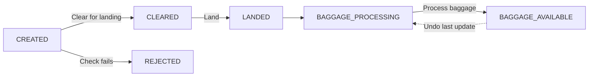
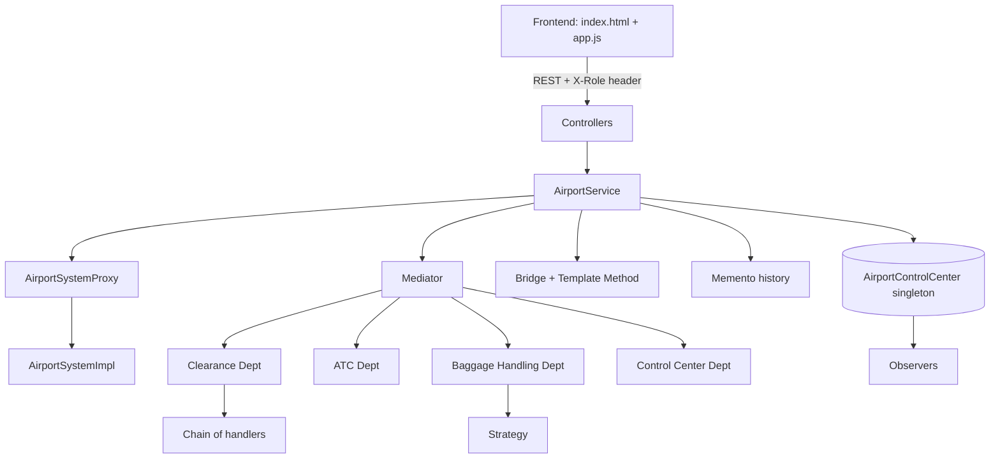

# Airport Flight & Baggage Management System


A Spring Boot web application that simulates how an airport takes a flight from creation to baggage delivery, built to show **13 classic (GoF) design patterns working together in one realistic workflow** instead of in isolated toy examples.

**Live demo:** https://airport-baggage-system.onrender.com
(hosted on a free tier: the first request after inactivity can take about a minute to wake the app up)

## What it does

Airport staff create flights, clear them for landing, land them, assign baggage belts, set the expected baggage slot and process baggage. Passengers see live flight and baggage status. Every status change produces notifications for the passenger, the display board, staff and the control center.

Example: flight `AI-202` (Domestic) lands at 10:00 AM, gets belt `B3` automatically, and the expected baggage slot becomes `10:15 AM - 10:30 AM`.

Built for the Design Patterns Laboratory course.

## Table of Contents

- [Features](#features)
- [Tech Stack](#tech-stack)
- [Quick Start](#quick-start)
- [Try It in 2 Minutes](#try-it-in-2-minutes)
- [How It Works](#how-it-works)
- [Design Patterns](#design-patterns)
- [Architecture](#architecture)
- [REST API](#rest-api)
- [Project Structure](#project-structure)
- [Testing](#testing)
- [Deployment](#deployment)
- [Documentation](#documentation)
- [Limitations](#limitations)
- [Project History](#project-history)
- [Author](#author)

## Features

- Create Domestic, International or Cargo flights with input validation
- Clone an existing flight as a template for a new one
- Multi-step landing clearance: Operations, ATC, Security, Manager approval
- Landing automatically assigns a baggage belt and calculates the expected baggage slot
- Re-assign belts using Normal or Priority rules, or pick a belt manually
- Process baggage as Regular or Priority, with Manual or Automated handling
- Live notification log for passengers, display board, staff and control center
- Undo the last update using saved snapshots (up to 5 per flight)
- Role-based access: Passenger (read-only), Staff, Admin
- Single-page frontend served by the same Spring Boot app, no separate frontend server

## Tech Stack

| Layer | Technology |
|---|---|
| Language | Java 17 |
| Backend | Spring Boot 3.3 (REST API) |
| Frontend | Plain HTML, CSS, JavaScript |
| Build | Maven |
| Testing | JUnit 5 |
| Storage | In-memory (no database) |
| Deployment | Docker, Render |

## Quick Start

Requires JDK 17+ and Maven 3.8+.

```bash
git clone https://github.com/iyersriram042006/airport-flight-baggage-system.git
cd airport-flight-baggage-system
mvn spring-boot:run
```

Open http://localhost:8080. Backend and frontend start together.

Demo logins (hardcoded, for lab use only):

| Username | Password | Role |
|---|---|---|
| staff1 | staff123 | Staff |
| admin1 | admin123 | Admin |
| passenger1 | pass123 | Passenger |

Without logging in you are a read-only Passenger. The app starts with three sample flights: `AI-202` (Domestic), `6E-451` (International) and `UK-803` (Cargo).

## Try It in 2 Minutes

1. Log in as `staff1`.
2. Select `AI-202` and click **Clear for landing**. The Last result panel shows each step of the clearance chain.
3. Click **Mark landed**. A belt and an expected baggage slot appear automatically.
4. Choose **Auto belt: Priority** and click **Assign belt** to move the flight to a priority belt.
5. Click **Process baggage** and compare the workflow steps for Regular/Manual vs Priority/Automated.
6. Click **Undo last update** to roll the flight back to its previous saved state.
7. Log out and notice that action buttons are disabled for a Passenger.

The full presentation script is in [docs/DEMO.md](docs/DEMO.md).

## How It Works

### Flight lifecycle



### Which patterns run at each step

```
Create  : Builder -> Factory Method -> Abstract Factory (gate + baggage service)
Clear   : Proxy -> Mediator -> Chain (Operations -> ATC -> Security -> Manager)
Land    : Proxy -> Mediator -> ATC lands -> Baggage Handling assigns belt (Strategy) + slot
Baggage : Proxy -> Template Method + Bridge (type x handling method)
Undo    : Proxy -> Memento restores the last snapshot
Always  : Observer notifies passenger, display board and staff on every status change
```

### Baggage belts

Four belts, `B1` to `B4`. `B1` and `B2` are priority belts, `B3` and `B4` are regular. The Normal strategy prefers regular belts, the Priority strategy prefers priority belts, and both fall back to any free belt. A belt can never be held by two flights.

## Design Patterns

| # | Pattern | Problem it solves here | Main classes |
|---|---|---|---|
| 1 | Singleton | One shared airport state | `AirportControlCenter` |
| 2 | Factory Method | Create the right flight subtype | `FlightFactory` and its Domestic/International/Cargo subclasses |
| 3 | Proxy | Role-based access control | `AirportSystemProxy`, `AirportSystemImpl` |
| 4 | Abstract Factory | Matching gate + baggage service family | `AirportResourceFactory`, `DomesticAirportFactory`, `InternationalAirportFactory` |
| 5 | Bridge | Baggage type and handling method vary independently | `BaggageProcessor`, `BaggageHandlingImplementor` |
| 6 | Chain of Responsibility | Clearance checks in sequence | `ClearanceHandler` and its Operations/ATC/Security/Manager handlers |
| 7 | Observer | Notify on every status change | `Flight` (subject), `FlightObserver` and its Passenger/DisplayBoard/Staff observers |
| 8 | Builder | Many required and optional flight fields, validated | `FlightBuilder` |
| 9 | Prototype | Create a flight from an existing one | `FlightPrototype`, `Flight.cloneWith()` |
| 10 | Mediator | Departments coordinate without knowing each other | `AirportControlMediator` and the four departments |
| 11 | Template Method | Fixed baggage workflow with varying steps | `BaggageProcessor.process()` |
| 12 | Strategy | Interchangeable belt-assignment rules | `BeltAssignmentStrategy`, `BeltAssigner` |
| 13 | Memento | Undo a wrong update from a real snapshot | `FlightSnapshot`, `FlightHistory` |

Several patterns are deliberately kept separate so they do not overlap: Mediator coordinates departments while Chain still performs the clearance checks, Strategy picks the belt while Template Method fixes the order of baggage steps and Bridge supplies how handling is done, and Observer only notifies while Memento only saves and restores. Details are in [docs/PATTERNS.md](docs/PATTERNS.md).

## Architecture



Controllers stay thin and delegate to `AirportService`, which is where the patterns are wired together. All state lives in the `AirportControlCenter` singleton.

## REST API

Protected endpoints read the role from the `X-Role` header (the frontend sets it after login). A few main endpoints:

| Method and path | Role | Purpose |
|---|---|---|
| `POST /api/auth/login` | any | Log in, returns username and role |
| `GET /api/flights` | any | List all flights |
| `POST /api/flights` | any | Create a flight (Builder) |
| `POST /api/flights/{id}/clear` | Staff/Admin | Clear for landing (Mediator + Chain) |
| `POST /api/flights/{id}/land` | Staff/Admin | Land, assign belt and slot |
| `PUT /api/flights/{id}/baggage/status` | Staff/Admin | Process baggage (Template Method + Bridge) |
| `POST /api/flights/{id}/restore` | Staff/Admin | Undo last update (Memento) |

Example:

```bash
curl http://localhost:8080/api/flights

curl -X POST http://localhost:8080/api/flights/FL1/clear -H "X-Role: STAFF"
```

Flight IDs look like `FL1`, `FL2`. The complete list of endpoints with request bodies is in [docs/API.md](docs/API.md).

## Project Structure

```
.
├── pom.xml
├── Dockerfile
├── README.md
├── docs/
│   ├── PATTERNS.md        pattern-by-pattern map
│   ├── API.md             REST endpoints
│   └── DEMO.md            presentation walkthrough
└── src/
    ├── main/
    │   ├── java/com/airport/
    │   │   ├── AirportApplication.java
    │   │   ├── controller/        REST controllers
    │   │   ├── service/           AirportService
    │   │   ├── dto/               request objects
    │   │   ├── model/             Flight, Baggage, status enums
    │   │   ├── singleton/         Singleton
    │   │   ├── factory/           Factory Method
    │   │   ├── abstractfactory/   Abstract Factory
    │   │   ├── builder/           Builder
    │   │   ├── prototype/         Prototype
    │   │   ├── proxy/             Proxy + auth
    │   │   ├── chain/             Chain of Responsibility
    │   │   ├── mediator/          Mediator
    │   │   ├── observer/          Observer
    │   │   ├── bridge/            Bridge + Template Method
    │   │   ├── strategy/          Strategy
    │   │   └── memento/           Memento
    │   └── resources/
    │       ├── application.properties
    │       └── static/            index.html, app.js, style.css
    └── test/java/com/airport/
        └── PatternsTest.java
```

## Testing

```bash
mvn test
```

`PatternsTest` contains 21 JUnit 5 tests (no Spring context) covering all 13 patterns, including:

- Builder validation of required fields
- Clone independence: original untouched, clone starts as `CREATED` with no belt
- Mediator coordination without duplicate notifications
- Normal vs Priority belt rules and belt occupancy
- Template Method: identical step order, differing steps
- Memento: flight state restored, belt released, baggage record removed, unrelated flights untouched, role check, 5-snapshot limit

## Deployment

The app reads its port from the `PORT` environment variable (default 8080), so it runs on most hosting platforms without changes.

**Docker**

```bash
docker build -t airport .
docker run -p 8080:8080 airport
```

**Render (what the live demo uses)**

1. Create a new Web Service on [render.com](https://render.com) from this GitHub repository.
2. Choose Docker as the runtime (the included `Dockerfile` is detected automatically) and the Free instance type.
3. Deploy. Every push to `main` redeploys automatically.

Free instances sleep after 15 minutes without traffic, and because data is in-memory, it resets to the three sample flights when the app restarts.

## Documentation

- [docs/PATTERNS.md](docs/PATTERNS.md): pattern map and how the patterns cooperate
- [docs/API.md](docs/API.md): REST API reference
- [docs/DEMO.md](docs/DEMO.md): step-by-step demonstration script

## Limitations

- In-memory only: flights, baggage and undo history reset on restart.
- Authentication uses hardcoded demo users and a client-supplied `X-Role` header. Fine for a lab, not secure for real use.
- Expected baggage slot is simply landing time plus 15 to 30 minutes, with no prediction logic.
- Auto-assignment on landing always uses the Normal strategy; use the Assign belt action to switch to Priority.
- If a restored belt was taken by another flight in the meantime, the flight is restored without a belt.

## Project History

This project was presented in two stages:

1. **Presentation 1:** console application demonstrating 7 patterns (Singleton, Factory Method, Proxy, Chain of Responsibility, Abstract Factory, Bridge, Observer). Preserved at git tag `v1-terminal-7-patterns`:
   ```bash
   git checkout v1-terminal-7-patterns
   ```
2. **Presentation 2:** this Spring Boot web application with 13 patterns (adds Builder, Prototype, Mediator, Template Method, Strategy, Memento).

## Author

Sriram, Ramdeobaba University (RBU), Nagpur
